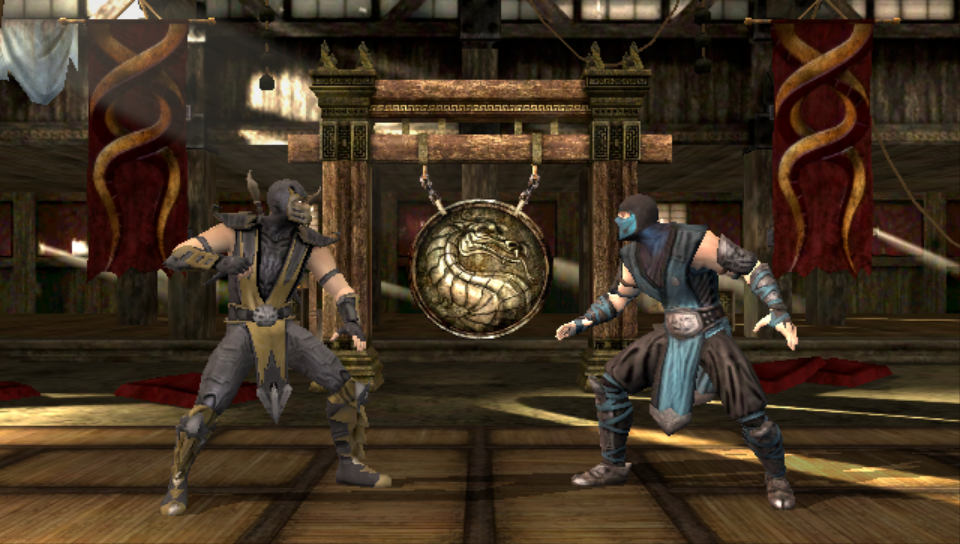
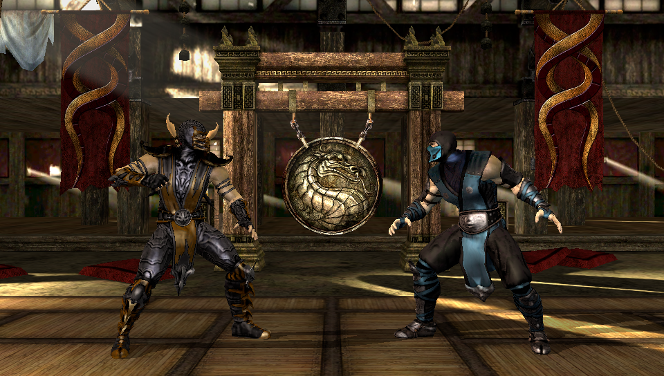

# Mortal Kombat 9 Remaster 

The mod does not provide the original game files. You must own the PC version of MK9 and PS Vita to install it.  

Graphics mod for MK9.  
-Ported 3D Models, Textures, Lightmaps from PC  
-Shaders that disabled on PS Vita have been baked into textures  
-Ported X-Ray  
-Upscaled internal resolution from 640x368 to 960x544 ( thanks to [Electry](https://github.com/Electry/VitaGrafixPatchlist/)  )  
